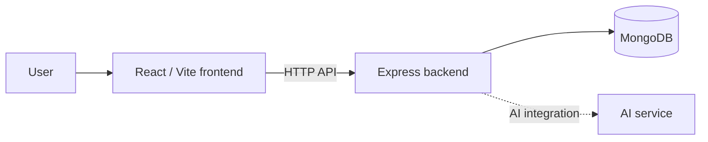

PlaceMentor
AI-powered interview practice and placement readiness platform

PlaceMentor is a MERN-stack web application designed to help students and job seekers prepare for technical interviews, evaluate their resumes, identify skill gaps, and track their preparation progress through a unified dashboard.

Features
Module	Functionality
Authentication	Registration, login and target-role selection
Personalized dashboard	Placement Readiness Score (PRS), resume score, interview summaries and learning recommendations
Mock interviews	Role, company, difficulty and question-count selection
AI interview room	Interview prompts, webcam preview and answer recording interface
Resume analyzer	PDF/DOCX upload, resume strength and ATS compatibility scores, skill identification and suggestions
Performance analytics	Interview trends, score distribution, skill progress and interview history
Leaderboard	PRS-based rankings and user search
Community	Interface for sharing interview experiences, likes, comments and following users
Career insights	Trending interview questions and hiring information panels

Application walkthrough
1. Personalized dashboard
Track readiness and identify skills to improve using recommended learning paths.

2. Configurable mock interviews
Select a target role, company-style interview, difficulty and question count. Company names indicate practice categories, not official affiliations.

3. AI interview experience
Practice responding to interview prompts in an interview-room interface with camera preview and answer recording.

4. Resume analysis and skill gaps
Review resume strength, estimated ATS compatibility, detected skills, missing skills and improvement suggestions. These scores are guidance, not guarantees of hiring outcomes.

5. Performance analytics
Visualize interview scores, progress and preparation history.

6. Leaderboard and community
Explore readiness rankings and share preparation experiences with other learners.

Screenshots illustrate the application interface. Displayed scores, hiring figures, member counts and rankings are not verified production metrics. Some analytics records in the screenshots are incomplete.

Technology stack
Layer	Technologies
Frontend	React 18, Vite, Tailwind CSS, React Router, Axios
Backend	Node.js, Express 5
Database	MongoDB, Mongoose
Authentication libraries	JSON Web Token, bcryptjs
AI integration dependency	OpenAI SDK
Visualization	Recharts, Chart.js, react-chartjs-2
Document processing	PDF.js, Mammoth, Multer
Camera interface	react-webcam

Architecture

Repository structure
PlaceMentor/
├── backend/
│   ├── config/
│   ├── routes/
│   ├── server.js
│   └── package.json
├── src/
├── screenshots/       # README assets supplied with this documentation
├── index.html
├── package.json
├── tailwind.config.js
├── postcss.config.js
├── vite.config.js
└── README.md
Getting started
Prerequisites
- Node.js 22.13+ (or a compatible newer LTS release) and npm
- MongoDB instance or MongoDB Atlas connection
- API credentials for any enabled external AI or career-data integrations
- Browser with camera and microphone permissions for interview features
Clone and install
git clone https://github.com/ekluthakur/PlaceMentor.git
cd PlaceMentor
npm ci
cd backend
npm install
Environment configuration
Create a local backend/.env file. Inspect backend/config/db.js, authentication and AI modules for the exact environment variable names required by your checkout. Configure the MongoDB connection, JWT signing secret and any required API credentials. Do not commit credentials or include them in frontend code.
Start backend
From the backend directory:
npm run dev
Backend: http://localhost:5000
Start frontend
In a second terminal, from the repository root:
npm run dev
Frontend default: http://localhost:5173

To build the frontend for production, run npm run build from the root. Verify frontend API configuration before deploying.
API route groups
The Express server mounts the following route groups:
Prefix	Area
/api/auth	Authentication
/api/interview	Interviews
/api/answers	Answers
/api/resume	Resumes
/api/ai	AI integration
/api/learning	Learning
/api/github	GitHub integration
/api/jobs	Jobs
/api/leaderboard	Leaderboard

Consult the individual route files for supported methods, request formats and authorization requirements.
Future improvements
- Validate incomplete interview records and date formatting.
- Keep dashboard and analytics calculations consistent.
- Clearly distinguish live hiring information from demonstration data.
- Add automated tests and verified deployment instructions.
- Document recording consent, resume retention and privacy controls.
Repository
View PlaceMentor on GitHub

If you find this project useful, consider starring the repository or opening an issue with feedback.
