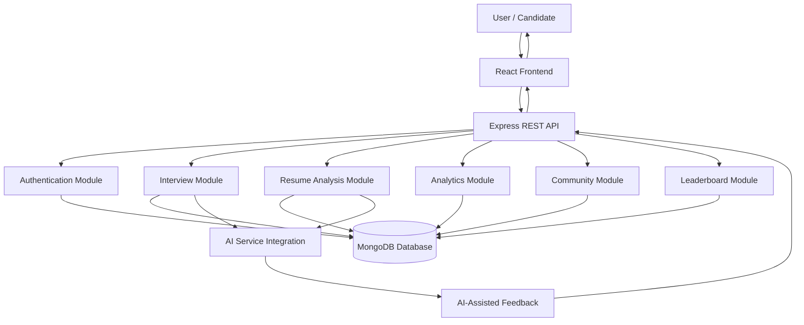
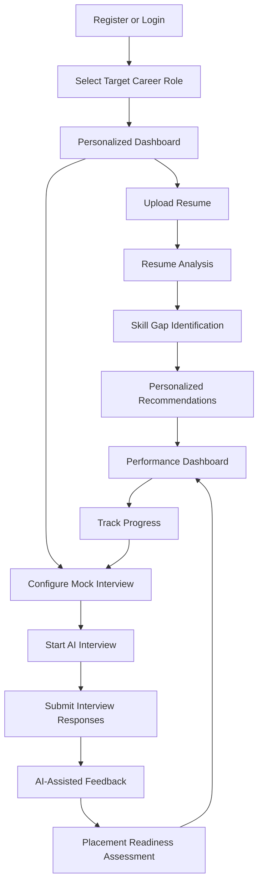

<div align="center">

# 🤖 PlaceMentor

### AI-Powered Mock Interview & Placement Preparation Platform

**Practice Smarter. Identify Skill Gaps. Build Confidence. Get Placement Ready.**

PlaceMentor is an AI-powered full-stack web application designed to help students and aspiring professionals prepare for technical interviews, analyze resumes, identify skill gaps, and track their placement readiness through intelligent feedback and performance analytics.


[Overview](#-project-overview) •
[Features](#-key-features) •
[Screenshots](#-application-preview) •
[Architecture](#-system-architecture) •
[Installation](#-installation-and-setup)

</div>

---

## 📌 Project Overview

PlaceMentor is an intelligent placement preparation platform that combines AI-assisted mock interviews, resume analysis, personalized learning recommendations, and performance tracking within a unified digital environment.

The platform enables users to practice role-specific and company-oriented interviews, receive AI-assisted feedback, evaluate resume compatibility, and monitor their preparation journey using a Placement Readiness Score (PRS).

Unlike traditional interview preparation platforms that primarily provide static question banks, PlaceMentor focuses on interactive practice, personalized recommendations, and data-driven performance improvement.

---

## 🎯 Problem Statement

Students and job seekers often face several challenges during placement preparation:

- Limited access to realistic mock interview experiences.
- Lack of personalized feedback on interview performance.
- Difficulty identifying technical skill gaps.
- Limited understanding of resume strength and ATS compatibility.
- Absence of structured performance tracking.
- Fragmented resources for interview preparation and career guidance.

PlaceMentor addresses these challenges by integrating interview practice, resume evaluation, skill assessment, and performance analytics into a single platform.

---

## ✨ Key Features

| Feature | Description |
| :--- | :--- |
| AI Mock Interviews | Interactive interview practice based on selected roles, companies, and difficulty levels. |
| Resume Analyzer | Resume strength evaluation, ATS compatibility assessment, and improvement suggestions. |
| Placement Readiness Score | A consolidated score representing placement preparation progress. |
| Skill Gap Detection | Identification of missing technical skills based on career objectives. |
| Personalized Learning Path | Recommended learning topics to address identified skill gaps. |
| Performance Analytics | Visual representation of interview scores, skill progress, and historical performance. |
| Interview Recommendations | Suggested interview topics aligned with the user's target role. |
| Leaderboard | PRS-based rankings that support competitive learning. |
| Community Platform | Share interview experiences, interact with peers, and participate in discussions. |
| User Authentication | Account registration, login, and personalized user access. |
| Hiring Insights | Dedicated interface for hiring trends, interview questions, and company information. |

---

## 🖥️ Application Preview

### 1. Landing Page

The landing page introduces PlaceMentor's core capabilities and provides users with direct access to interview preparation, resume analysis, and account registration.

<div align="center">
  
</div>

### 2. User Registration and Authentication

Users can create personalized accounts by selecting their target career role. The platform provides registration and login interfaces for accessing individual preparation dashboards.

Supported target roles include:

- Software Developer
- Frontend Developer
- Backend Developer
- Data Analyst

<table>
  <tr>
    <td align="center">
      <strong>Registration</strong>
    </td>
    <td align="center">
      <strong>Login</strong>
    </td>
  </tr>
  <tr>
    <td>
      
    </td>
    <td>
      
    </td>
  </tr>
</table>

### 3. Personalized Dashboard

The dashboard provides a centralized overview of the user's placement preparation journey.

Key functionalities include:

- Placement Readiness Score (PRS).
- Completed interview count.
- Resume strength score.
- Technical skill gap identification.
- Suggested learning paths.
- AI-recommended interview topics.

<div align="center">
  
</div>

### 4. Configurable Mock Interviews

Users can customize their mock interview sessions according to their career objectives and preparation requirements.

The interview configuration module supports:

- Target job role selection.
- Company-oriented interview preparation.
- Easy, Medium, and Hard difficulty levels.
- Configurable number of questions.
- Estimated interview duration.
- Interview configuration preview.

The interface includes preparation options for eight companies:

Google, Amazon, Microsoft, Meta, TCS, Infosys, Wipro, and Accenture.

<div align="center">
  
</div>

### 5. AI-Powered Interview Room

The AI interview room provides an interactive environment designed to simulate a technical interview experience.

Core capabilities include:

- AI-assisted interview questions.
- Interactive question-and-answer sessions.
- Camera-enabled interview interface.
- Voice response recording.
- Interview performance evaluation.
- AI-assisted feedback.

<div align="center">
  
</div>

### 6. AI Resume Analyzer

The resume analysis module helps candidates understand their resume quality and identify areas requiring improvement.

Users can upload resumes in supported document formats and access structured evaluation results.

<table>
  <tr>
    <td align="center">
      <strong>Resume Upload</strong>
    </td>
    <td align="center">
      <strong>Resume Analysis Results</strong>
    </td>
  </tr>
  <tr>
    <td>
      
    </td>
    <td>
      
    </td>
  </tr>
</table>

The resume analysis interface provides:

- Resume Strength Score.
- ATS Compatibility Score.
- Detected technical skills.
- Missing technical skills.
- Resume improvement recommendations.
- Suggestions for improving project descriptions and achievements.

The scores are intended as preparation guidance rather than guarantees of recruitment outcomes.

### 7. Performance Analytics

The analytics dashboard enables users to monitor their interview preparation progress through visual performance indicators.

Key analytical components include:

- Total interview count.
- Average Placement Readiness Score.
- Best interview score.
- Interview performance trend.
- Skill progress visualization.
- PRS distribution.
- Historical interview records.

<div align="center">
  
</div>

<div align="center">
  
</div>

### 8. Hiring and Interview Insights

The platform includes a dedicated interface for exploring company-oriented interview questions and hiring-related information.

The module presents:

- Trending interview topics.
- Company-specific interview questions.
- Hiring trend information.
- Hiring status indicators.
- Recommended preparation opportunities.

<div align="center">
  
</div>

### 9. Placement Readiness Leaderboard

The leaderboard introduces a competitive learning environment by displaying user rankings based on Placement Readiness Scores.

Features include:

- PRS-based user rankings.
- Top-performing user highlights.
- User search functionality.
- Top 10 ranking filter.

<div align="center">
  
</div>

### 10. Community and Peer Learning

The community module provides a collaborative environment where users can share their preparation experiences and learn from other candidates.

Community functionalities include:

- Creating and sharing posts.
- Sharing interview experiences.
- Liking and commenting on posts.
- Following other users.
- Exploring preparation topics.
- Viewing trending posts and contributors.

<div align="center">
  
</div>

---

## 🛠️ Technology Stack

### Frontend

| Technology | Purpose |
| :--- | :--- |
| React.js | Component-based user interface development |
| JavaScript | Application logic and interactivity |
| Vite | Frontend development and build tooling |
| Tailwind CSS | Responsive styling and UI design |
| Recharts | Performance charts and data visualization |

### Backend

| Technology | Purpose |
| :--- | :--- |
| Node.js | Server-side JavaScript runtime |
| Express.js | REST API development and request handling |
| JWT | Token-based user authentication |

### Database

| Technology | Purpose |
| :--- | :--- |
| MongoDB | Document-oriented application data storage |
| Mongoose | Database modeling and interaction |

### Artificial Intelligence

| Technology | Purpose |
| :--- | :--- |
| OpenAI SDK | AI service integration |
| AI-Assisted Evaluation | Interview feedback and resume analysis |
| Browser Media APIs | Camera and microphone interaction |

### Development Tools

| Technology | Purpose |
| :--- | :--- |
| Git | Version control |
| GitHub | Source code management |
| npm | Dependency management |

---

## 🏗️ System Architecture

PlaceMentor follows a full-stack client-server architecture that separates the presentation layer, application logic, database management, and AI service integration.



### Architecture Components

- **Presentation Layer:** React-based interface for interacting with application modules.
- **Application Layer:** Node.js and Express.js backend responsible for application logic and API communication.
- **Data Layer:** MongoDB database for managing application records.
- **AI Integration Layer:** AI-assisted interview and resume evaluation.
- **Analytics Layer:** Performance visualization and placement readiness tracking.

---

## 🔄 Application Workflow



The application follows a continuous improvement cycle:

**Assess → Practice → Evaluate → Identify Gaps → Improve → Repeat**

---

## 📊 Placement Readiness Score (PRS)

The Placement Readiness Score is a central performance indicator used within PlaceMentor to help candidates understand and monitor their preparation progress.

The platform presents PRS alongside:

- Interview performance.
- Resume evaluation.
- Technical skill progress.
- Historical interview results.
- Personalized improvement recommendations.

Users can track their progress through analytical dashboards and identify areas that require further preparation.

---

## 📂 Project Structure

The application is organized into frontend, backend, and documentation components.

```text
PlaceMentor/
│
├── backend/                  # Backend application
│   ├── models/               # Database models
│   ├── routes/               # API routes
│   ├── package.json          # Backend dependencies
│   └── ...                   # Server and supporting modules
│
├── src/                      # React frontend source
│   ├── components/           # Reusable UI components
│   ├── pages/                # Application pages
│   └── ...                   # Frontend logic and assets
│
├── public/                   # Public application assets
│
├── screenshots/              # Application documentation images
│
├── package.json              # Frontend dependencies
├── README.md                 # Project documentation
└── .gitignore                # Git exclusion configuration
```

---

## 🚀 Installation and Setup

Follow the instructions below to run PlaceMentor in a local development environment.

### Prerequisites

Ensure the following tools are installed:

- Node.js
- npm
- MongoDB or MongoDB Atlas
- Git
- API credentials for the configured AI service

### Step 1: Clone the Repository

```bash
git clone https://github.com/ekluthakur/PlaceMentor.git
```

### Step 2: Navigate to the Project Directory

```bash
cd PlaceMentor
```

### Step 3: Install Frontend Dependencies

```bash
npm install
```

### Step 4: Install Backend Dependencies

```bash
cd backend
npm install
```

### Step 5: Configure Environment Variables

Create a `.env` file inside the backend directory and configure the environment variables required by the backend.

Example configuration:

```env
PORT=5000
MONGO_URI=your_mongodb_connection_string
JWT_SECRET=your_jwt_secret
OPENAI_API_KEY=your_api_key
```

> The variable names above are illustrative. Verify the exact environment variable names against the backend source code before running the application.

Never commit API keys, database credentials, JWT secrets, or `.env` files to the repository.

### Step 6: Start the Backend Server

From the backend directory, run the start or development script defined in its `package.json`.

For example, if the development script is configured:

```bash
npm run dev
```

### Step 7: Start the Frontend

Open another terminal and navigate to the project root.

```bash
npm run dev
```

### Step 8: Access the Application

Open the frontend URL displayed in the terminal.

The default Vite development URL is typically:

```text
http://localhost:5173
```

---

## 🔌 Backend Modules

The backend is responsible for managing communication between the frontend, database, and AI services.

| Module | Responsibility |
| :--- | :--- |
| Authentication | User registration and login |
| User Management | User profile and career preferences |
| Interview Management | Interview configuration and response handling |
| AI Integration | AI-assisted question generation and evaluation |
| Resume Analysis | Resume processing and evaluation |
| Analytics | Interview history and performance tracking |
| Leaderboard | Placement Readiness Score rankings |
| Community | Posts, likes, comments, and user interactions |

---

## 💡 Project Highlights

- Full-stack web application developed using the MERN stack.
- AI-assisted technical interview preparation.
- Configurable interview practice for eight target companies.
- Three interview difficulty levels.
- Resume analysis with ATS compatibility assessment.
- Personalized skill gap detection and learning recommendations.
- Interactive performance visualization and historical analytics.
- Integrated leaderboard and community engagement features.
- Modular frontend and backend architecture.
- Unified platform for placement preparation and progress tracking.

---

## 🔮 Future Enhancements

Potential improvements for future development include:

- Real-time coding interview environment.
- Integrated code editor and automated test case evaluation.
- Adaptive interview difficulty based on previous performance.
- Advanced speech analysis and communication feedback.
- Multilingual interview support.
- Resume comparison against specific job descriptions.
- Integration with verified job listing APIs.
- Personalized preparation roadmaps.
- Interview report export functionality.
- Enhanced accessibility and mobile responsiveness.
- Automated testing and CI/CD integration.

---

## 🤝 Contributing

Contributions, suggestions, and improvements are welcome.

To contribute to the project:

1. Fork the repository.
2. Create a new feature branch.

```bash
git checkout -b feature/your-feature-name
```

3. Implement your changes.
4. Commit your changes.

```bash
git commit -m "feat: add new functionality"
```

5. Push your feature branch.

```bash
git push origin feature/your-feature-name
```

6. Open a Pull Request describing your changes.

---

## 🔐 Security and Privacy

PlaceMentor handles user-related information, including account details, resumes, and interview responses.

When developing or deploying the application:

- Keep API credentials and database secrets outside the source code.
- Configure environment variables securely.
- Request user permission before accessing camera or microphone functionality.
- Avoid exposing personal information in public logs or documentation.
- Review authentication and authorization before production deployment.
- Use demonstration data when publishing application screenshots.

---

## ⚠️ Disclaimer

PlaceMentor is designed as an educational and career preparation platform.

AI-generated feedback, resume scores, ATS compatibility assessments, and Placement Readiness Scores are intended to support preparation and self-assessment. They do not guarantee interview selection, employment, or recruitment outcomes.

Company names are used for interview preparation context and do not imply official affiliation or endorsement.

---

## 🔗 Repository

**GitHub Repository:**  
https://github.com/ekluthakur/PlaceMentor

---

<div align="center">

### ⭐ Support the Project

If you find PlaceMentor useful, consider giving the repository a star.

**Empowering candidates through AI-driven interview preparation and intelligent career development.**

Built with React, Node.js, Express.js, MongoDB, and Artificial Intelligence.

</div>
